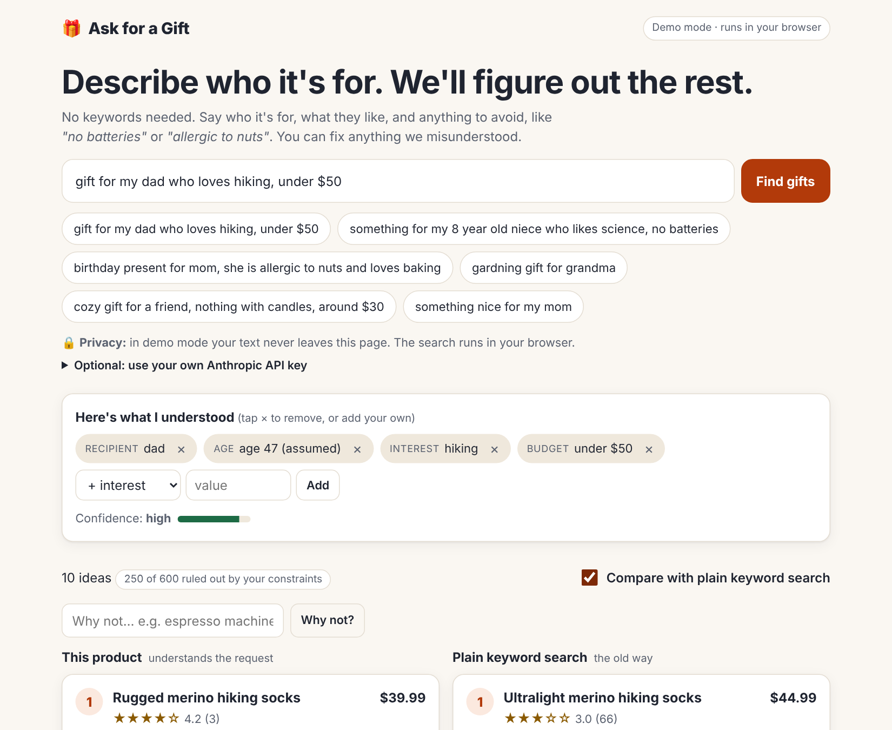

# 🎁 Ask for a Gift

**Describe who the gift is for in plain words. Get ranked ideas with a reason for each, fix what the system misunderstood, and ask "why not X?"**

> **Everything here runs on a synthetic catalog.** The 600 products, prices, ratings and reviews are invented by a script. Every number in this README is a measurement on that catalog, not on real shoppers or a real retailer.

## 1. The user and the problem

A parent or friend buying a gift for someone else knows the person but not the product vocabulary, so they type things like "something for my dad who likes being outdoors, not too expensive" into a search box built for people who already know the word "trekking poles". Keyword search then returns nothing, or returns items that break what they said (searching "no batteries" matches battery products because the word "batteries" is in them), or shows a long list with no reasons. Gifts also have a cost of error that ordinary shopping doesn't: a choking hazard for a toddler, an allergen, or a price over budget is worse than a missed sale.

## 2. Try it

**Live demo:** https://yutika-agarwal.github.io/ask-for-a-gift/ (after the first deploy; see [How to run locally](#8-how-to-run-locally) for the one-time Pages setting)



No setup: open it and click an example. Demo mode runs entirely in your browser and sends nothing anywhere. Optionally paste your own Anthropic API key to let Claude read the request instead of the built-in parser; the key lives only in that tab's memory and only your typed sentence goes to `api.anthropic.com`.

## 3. Why this design (and two alternatives I rejected)

**The shape:** type a sentence → see what was understood as editable chips (with a confidence level) → hybrid keyword + embedding retrieval under **hard constraints** → one transparent score → one-sentence reason per result → a toggle to compare with plain keyword search → thumbs and "why not X?".

**Rejected: a chatbot that asks questions and recommends.** It feels natural, but it hides what it understood, takes several turns to reach a first result, and gives the user nothing to correct except by typing more. Chips make the understanding visible and editable in one tap. The product asks at most one question, and only when the request is vague or contradicts itself.

**Rejected: embedding (semantic) search on its own, or "let the LLM rank everything".** It handles synonyms, but similarity cannot enforce "under $30", "no batteries" or "safe for a 3-year-old": a similar-sounding item is not a permitted item. In my eval embedding-only returned 42 price violations and 19 age-mismatch results in the top 10s. So constraints are hard filters applied *before* ranking, which is also what makes the guardrails testable at zero. The LLM is used for understanding (optional), not as an unverifiable ranker.

## 4. How I know it works

`npm run eval` scores four systems on 50 queries with graded labels ([eval/queries.json](eval/queries.json), written to be reviewed and edited). Full output with the failure gallery: [eval/RESULTS.md](eval/RESULTS.md).

**Caveats first.** (1) Synthetic catalog. (2) Labels are graded *specs*: category grades 0–3 plus hard constraints, applied to the catalog's structured fields. I wrote them; they are for you to review. (3) Because the constraints in the labels come from the same structured fields the pipeline filters on, the full pipeline's gains on budget, negation and safety queries are partly by construction: keyword and embedding search simply cannot apply those fields. Read those slices as "what constraint handling is worth", not as a general accuracy claim. (4) I tuned the pipeline while looking at this eval set (see the iteration log), so the full-pipeline number is optimistic. (5) The Claude-understanding path is built but **not evaluated**; run `npm run eval:llm` with a key to do so.

Mode: demo (deterministic rule-based understanding, no network). No cached LLM outputs exist, so none are used.

**NDCG@10 on the 42 queries that should return results**

| System | NDCG@10 |
|---|---|
| Keyword (BM25 on the raw query) | 0.667 |
| Embedding only (raw query) | 0.349 |
| Hybrid retrieval only (keyword + embedding fused, raw query) | 0.661 |
| **Full pipeline** (understanding + constraints + hybrid + ranking) | **0.903** |

**By query type** (n in brackets; the 8 `clarify` queries should get a question, not results, so the full pipeline has no NDCG there)

| Type | Keyword | Embedding | Hybrid retrieval | Full pipeline |
|---|---|---|---|---|
| simple (8) | 0.875 | 0.443 | 0.877 | 0.946 |
| multi (6) | 1.000 | 0.669 | 0.988 | 0.963 |
| budget (7) | 0.570 | 0.268 | 0.556 | 0.918 |
| negation (7) | 0.446 | 0.212 | 0.487 | 0.785 |
| safety (7) | 0.804 | 0.321 | 0.781 | 0.901 |
| misspelling (7) | 0.325 | 0.216 | 0.293 | 0.908 |
| clarify (8) | 0.400 | 0.633 | 0.682 | n/a |

What this says, plainly:
- **Embeddings added nothing on top of keyword here** (0.661 vs 0.667). The catalog text and the queries share a vocabulary, so there are few synonym gaps for embeddings to close, and my embeddings are small static word vectors (64-d, averaged), which are weak. A real catalog with messier titles would likely tell a different story; this one can't.
- **For clean simple and multi-interest queries, plain keyword search is as good as the full pipeline, and slightly better on multi-interest** (1.000 vs 0.963). The full pipeline wins where users state constraints or make typos: budget, negation, safety, misspelling.
- The full pipeline is not magic on misspellings: it fixes the ones within edit distance of a catalog word, and says what it changed.

**Constraint violations in the top 10 (across all 50 queries, judged against the gold constraints)**

| System | price | age | battery | allergen | small parts | avoid-list |
|---|---|---|---|---|---|---|
| Keyword | 45 | 3 | 6 | 8 | 3 | 32 |
| Embedding only | 42 | 19 | 1 | 6 | 0 | 20 |
| Hybrid retrieval only | 45 | 9 | 8 | 8 | 3 | 28 |
| Full pipeline | 0 | 0 | 0 | 0 | 0 | 0 |

Zero-result queries out of 50: keyword 6, embedding 4, full pipeline 0.

**Guardrail test** (`npm test`): 12,900 returned items across the 50 queries plus a generated grid of ages × topics × budgets × "no batteries"/"nut allergy" requests. **Price violations 0, unsafe-for-age 0, battery 0, allergen 0.** It fails the build on any violation.

**Clarifying questions:** 8 of 8 vague or contradictory queries correctly got a question. It also asked once when I had labelled the query answerable (q27, "hobby gift for grandpa that isn't a board game or puzzle", which names no actual hobby). I think the system is right and my label is debatable; I left the label so you can decide.

**Failure gallery** (all nine with the actual results: [eval/RESULTS.md](eval/RESULTS.md)):
- q14 "photography and travel": a "Travel sketchbook" ranks first because the word *travel* is in its name (grade 0).
- q40 "yoga mat for my sistr": only two yoga mats exist, and the lower slots fill with other kinds of *mat* (a baking mat, a sleeping pad); NDCG 0.36, the worst query.
- q25 "cozy gift for mom, no candles": a "cozy reading pillow" ranks 5th on the word *cozy*, outside the categories I labelled relevant.
- q02 "gift for a gardener": an "herb garden planter" filed under *cooking* ranks 4th and my labels call it irrelevant, which is arguably too strict.
- q27: asked a question where I'd labelled it answerable (above).
- q06, q07, q30, q31: the top results are all right but keyword search scores higher by 0.06 to 0.13 deeper in the list. I have not diagnosed why.

Most of these are keyword-in-the-name problems that a better embedding or a learned ranker would address.

**Iteration log** (kept honest; I changed things after seeing eval results):

| Step | Full-pipeline NDCG@10 | What changed |
|---|---|---|
| v0 | 0.528 | First run. A "max 3 per category" diversity rule capped single-topic searches (only 3 coffee items in the top 10); "gardener" wasn't recognised; "3 year old" with no interest asked a question while my label expected results. |
| v1 | 0.764 | Diversity cap raised, "gardener"-style word forms recognised, "no small parts" parsed. I also **changed label q29** (to "soft toy for my 3 year old, no small parts") because the old wording contradicted how I'd labelled q48. |
| v2 (current) | 0.903 | Replaced the category cap with de-duplication of colour variants. Fixed duplicated-adjective product names in the generator. Treated "surprise" as filler. |

The guardrail test also caught a real bug before this: "without anything that needs charging" was not parsed as *no batteries* and 5 battery products leaked through. Fixed, and the test now guards it.

## 5. Success metrics, guardrails, and the first experiment

Full definitions and event schema: [docs/metrics.md](docs/metrics.md).

- **North star:** successful-search rate (a session that searches, then saves or thumbs-up a top-10 result).
- **Inputs:** reformulation rate, add-to-wishlist rate, zero-result rate, clarification answer rate, chip-edit rate.
- **Guardrails:** price-constraint violations = 0, unsafe-for-age suggestions = 0 (both measured at 0 offline, above).
- **Not measured:** all behavioural metrics. There are no users. The page logs events in memory so the instrumentation exists, but nothing is sent anywhere.

**First experiment:** once a real catalog is plugged in, A/B real sessions: control = keyword search, treatment = chips + hybrid ranking + one clarifying question. Primary metric successful-search rate; guardrails stay at zero violations and thumbs-down on the top 3 doesn't rise. Sample size depends on a baseline I don't have; as an illustration only, detecting +4 points from an assumed 20% needs about 1,600 sessions per arm. Within it, test the open question of **assuming vs asking** a child's age.

## 6. Risks and mitigations

| Risk | Mitigation in this repo | What's still open |
|---|---|---|
| **Misuse: unsafe or age-inappropriate suggestions** (choking hazards, alcohol to a minor) | Age-minimum and small-parts are hard filters; adult-only items have age ≥ 21; guardrail tests at zero | Real catalogs have missing or wrong age data; a missing field must be treated as unsafe, which I haven't had to implement |
| **Misuse: prompt injection or a leaked key via the bring-your-own-key path** | Key held in memory only, never stored or logged; the model output is constrained to a JSON schema and only fills the editable chips; ranking and filters stay local and deterministic | Users must still be told to use a limited key (the page says so) |
| **Bias: stereotyped recipient assumptions** (what "mom" or "dad" likes) | The recipient-fit signal is only 15% of the score and never filters; interests stated by the user dominate; chips let the user override | My synthetic recipient tags reflect my own assumptions. A real system needs auditing for who gets shown what |
| **Bias: popularity feedback loop** | Bayesian rating shrinkage; ratings are 15% of the score | No exploration policy for new items |
| **Trust: fake-looking reviews** | All reviews are labelled "synthetic review" in the UI; no real people's data | In production, review integrity is its own project |
| **Trust: confident wrong answers** | Visible confidence, "not enough to go on" state, loose-match labels, one clarifying question, "why not?" | The confidence number is a heuristic, not calibrated |
| **Trust: overclaiming results** | Eval caveats stated above; failures shown | Labels need your review |

## 7. Roadmap

**Now (this repo):** the demo above, the eval, the guardrails.

**Next:** review and correct the labels; run and cache the Claude-understanding eval (`npm run eval:llm`); a calibrated confidence score; replace static word vectors with a real sentence-embedding model and re-run the eval; real-product sources (the [featured-picks slot](#featured-picks) is waiting on source lists); handle "missing age data means unsafe".

**Later:** live inventory and price feeds; learning-to-rank from thumbs; group gifting and gift registries; multilingual requests; an exploration policy for new products.

### Featured picks
The plan was to include about 50 real picks from public gift guides, credited and linked, with no copied text. Those sites block my build environment, so this is **not done**: the catalog is 100% synthetic today. Items carry a `source` field (`"synthetic"`) so credited picks can be added and reported as a separate slice.

## 8. How to run locally

```bash
git clone https://github.com/Yutika-agarwal/ask-for-a-gift.git
cd ask-for-a-gift
npm install
npm run dev        # open the printed URL
npm test           # guardrails: must print PASS
npm run eval       # regenerates eval/results.json and eval/RESULTS.md
npm run build      # static site in dist/
```

Regenerate data (optional, deterministic): `npm run catalog` (needs Python 3), and `scripts/build_vectors.py` for the word-vector table (needs `spacy`, `wordfreq`, and the `en_core_web_md` vocab folder; usage is in the script header).

**Deploy:** push to `main`. The workflow in `.github/workflows/pages.yml` runs the tests and eval, builds, and publishes. One-time setting: *Settings → Pages → Source: GitHub Actions*.

**Layout:** `src/engine/` (understanding, search, optional Claude call), `src/main.js` (UI), `data/catalog.json` (synthetic), `public/vectors.json` (word vectors), `eval/` (labels, scorer, guardrails, results), `docs/` (PRD, metrics).

**Data and licences:** code is MIT. The catalog is synthetic. Word vectors are a 64-d PCA reduction of spaCy's `en_core_web_md` vectors (GloVe-style, trained on public web text) limited to about 8,900 common and catalog words.
